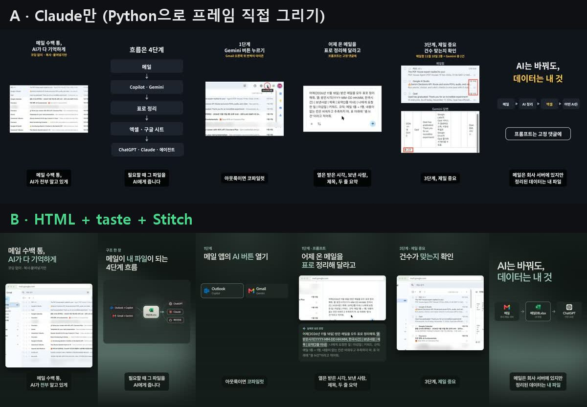

# 같은 쇼츠를 두 번 만들었다: Claude 혼자 그린 영상 vs HTML·taste·Stitch로 다시 그린 영상

> 대본, 자막, 장면 12개, 길이 2분 50초가 모두 같은 쇼츠 두 개를 비교했다. 하나는 Claude가 Python으로 프레임을 직접 그렸고, 다른 하나는 HTML로 다시 그리고 디자인 스킬 taste와 Google Stitch를 더했다. 차이를 만든 건 생각과 달리 Stitch가 아니라 **그리는 방식**이었다.

📺 **[비교 쇼츠 보기 (1분 30초)](https://youtube.com/shorts/0kufkbk7ci8)**

기록일: 2026년 11월 20일

## 비교한 두 영상

소재는 앞서 만든 "메일을 AI로 엑셀 DB 만들기" 쇼츠다. 원본은 [메일 정리, 코딩 없이 AI로 끝내기](https://youtube.com/shorts/ICMcA6WBfJw)로 올라가 있다.

| | A · Claude만 | B · HTML + taste + Stitch |
| --- | --- | --- |
| 그리는 방법 | Python(PIL)으로 프레임을 한 장씩 그림 | HTML/CSS 장면을 헤드리스 Chrome으로 캡처 |
| 디자인 | 남색 바탕, 기본 글꼴 | taste가 정한 녹회색 바탕, Pretendard |
| 길이·자막 | 2:50, 원본 대본 | 2:50, 원본 대본 그대로 |
| 파일 크기 | 9.7MB | 22.9MB |

## 무엇이 차이를 만들었나

처음에는 "Stitch를 붙이면 영상이 달라진다"는 이야기로 만들려고 했다. 그런데 12장면 파일을 하나씩 확인해 보니 기여 비중이 전혀 달랐다.

| 영향 | 맡은 일 | 해당 장면 |
| --- | --- | --- |
| **가장 큼: PIL → HTML 렌더 전환** | 실제 캡처를 브라우저 창 안에 넣고 카메라 이동·확대, 버튼 링, 내레이션에 맞춘 프롬프트 구절 강조, 숫자 카운트업, HTML 엑셀 재현 | 12장면 전체 |
| **중간: taste** | 색과 글꼴 결정, 구조도 다이어그램, 은은하게 움직이는 배경 | 전체 디자인, s03·s11·s12 |
| **작음: Stitch** | 앱처럼 보이는 AI 대화 화면 | s11 한 장면 (18초) |

두 영상을 나란히 봤을 때 "엄청 다르다"고 느낀 부분은 대부분 HTML 렌더 전환에서 나왔다. 이 연출은 Claude가 HTML과 CSS로 직접 짰다. 그래서 비교 쇼츠의 라벨과 제목도 처음 쓴 "Claude + Stitch"에서 "HTML + taste + Stitch"로 고쳤다. 한 도구를 내세우기보다 각 도구가 실제로 한 일을 적는 쪽이 맞다고 봤다.

## 비교 쇼츠 구성 (1분 30초)

| 시간 | 내용 |
| --- | --- |
| 0:00 | 같은 프레임을 A와 B로 나란히: "같은 대본, 그림만 바꿨다" |
| 0:05 | A와 B 소개 |
| 0:13 | 비교 1. 구조도: 상자와 화살표 vs 실제 앱 아이콘과 흐르는 선 |
| 0:28 | 비교 2. 실제 캡처: 캡처 그대로 vs 카메라 확대와 구절 강조 |
| 0:46 | 비교 3. 건수 확인: 나란히 놓기 vs 숫자가 올라가며 맞춰짐 |
| 0:57 | 비교 4. 대화 화면: Stitch가 직접 만든 장면 |
| 1:12 | 비용: 렌더 시간, 파일 크기, 따로 손본 문제 |
| 1:24 | "여러분 눈엔 어느 쪽이 나아요?" |

화면을 반으로 나누면 휴대폰에서 글자가 너무 작아진다. 그래서 본문은 A와 B를 전체 화면으로 번갈아 보여주고, 반 분할은 처음과 끝에만 썼다.

## 공짜는 아니었다

| | A | B |
| --- | --- | --- |
| 장면 2개 렌더 | 1분 미만 | 약 10분 |
| 12장면 전체 렌더 | - | 약 17분 (3개 병렬) |
| 파일 크기 (2:50) | 9.7MB | 22.9MB |

B 방식에서 따로 잡은 문제도 있었다.

- **배경 깜빡임**: taste 배경 효과의 자동 해상도 조절이 영상 렌더에서 3초마다 검은 프레임을 만들었다. 이 기능을 끄고 해결했다.
- **작은 글자**: 휴대폰에서 읽히도록 글자를 28px 이상으로 정했다.
- **지어낸 예시 데이터**: 시험판에서 대화 화면 답변에 지어낸 예시를 넣었다가, 실제 메일 DB 값으로 바꾸고 화면에 "예시 화면"이라고 표시했다.
- **개인정보**: 캡처 속 실명 결제 알림은 CSS가 아니라 이미지 자체에 블러를 넣었다.

## 비교 쇼츠를 만든 방법

1. 이전 대화 기록에서 대본에 넣을 점(기여 비중, 원본 1:1 유지, 예시 화면 표시, 비용, 화면 분할 문제)을 먼저 정리했다.
2. 두 원본 영상에서 같은 시점의 구간을 잘라 Python으로 다시 합성했다. 위에 A/B 라벨과 비교 번호를 붙이고, 원본 자막은 불투명한 패널로 덮어 새 자막을 넣었다.
3. 배경음은 원본 쇼츠의 배경음 앞 90초를 쓰고 끝 2초를 줄였다. 내레이션 음성은 넣지 않았다.
4. 렌더는 약 1분 15초 걸렸다. 프레임을 뽑아 자막 가림, 라벨 크기, 강조 표시 위치를 확인했다.

## 정리

- 영상 품질을 가장 크게 바꾼 건 **어떻게 그리느냐**(PIL → HTML)였다.
- taste는 디자인 기준을, Stitch는 실제 앱 같은 화면 재료를 맡는다. 둘 다 HTML로 그릴 때 힘을 쓴다.
- 대신 렌더 시간과 파일 크기가 늘고, 영상에서만 생기는 문제를 따로 잡아야 한다.
- 지금은 이 HTML 방식을 쇼츠 제작 스킬의 기본으로 쓰고, 빠른 초안이 필요할 때만 PIL 방식을 쓴다.

▶ **[비교 쇼츠 보기](https://youtube.com/shorts/0kufkbk7ci8)**

---

이 글은 실제 제작 과정을 바탕으로 쓴 개인 기록이다. Google Stitch, taste-skill, Anthropic으로부터 후원이나 대가를 받지 않았다.
